## 👋 About me

Final-year **B.Tech student in Artificial Intelligence & Machine Learning** based in Telangana, India. I build **LLM-powered multi-agent systems**, **cost-aware model routing**, and **mechanistic interpretability** tooling — then measure whether they actually work.

- 🔬 **Research-grade repos, not demos.** Each flagship project ships a pre-registration, a reproduction script, a test suite and CI — and reports the results that *didn't* hold alongside the ones that did.
- 🤖 **Agents & orchestration.** Multi-agent coordination, ReAct and Reflexion loops, debate agents, confidence-based escalation, and market-based compute allocation.
- 🧠 **Interpretability & LLM internals.** Sparse autoencoders, feature absorption, and a decoder-only language model trained from scratch.
- ⚙️ **Systems that run.** FastAPI backends, WebSocket dashboards, Docker, `pytest`, GitHub Actions.
- 📄 **Published** in *HBRP Publication* (2025) and **winner** of the Smart India Hackathon 2026 internal round.
- 🎯 **Looking for** an entry-level AI/ML or Generative AI engineering role.

## 🛠️ Tech stack

**Languages & core** — Python · Java · C · SQLite · PostgreSQL

**AI / ML** — PyTorch · scikit-learn · NumPy · pandas · SciPy · Matplotlib · Seaborn

**LLM & agentic AI** — Anthropic Claude · OpenAI · Gemini · Hugging Face · Groq · LiteLLM · RAG · Multi-agent systems

**Backend & data** — FastAPI · Node.js · Docker · SQLAlchemy · Jupyter · REST APIs · WebSockets

**Frontend** — TypeScript · React · Tailwind CSS · Vite · three.js

**Tooling & practice** — Git · GitHub · GitHub Actions · VS Code · Linux · pytest · Ruff · pre-commit · DVC

## 🚀 Flagship AI/ML work

> The four projects I would most like to be judged on. Every number below is produced by the code in its repository.

### 🛡️ [HorizonGuard](https://github.com/MuzraFatima/HorizonGuard) — recoverability-aware early warning for long-horizon agents

Most agent monitors predict failure. An accurate failure predictor can still make agents *worse*, because an alarm at the wrong moment breaks a run that would have succeeded. HorizonGuard forecasts, per step, whether a goal re-anchoring intervention would **rescue** or **disrupt** the run, acts only when rescue wins, and **certifies** how often it causes harm.

| Arm (40 seeds, fork-controlled closed loop) | Violation rate | Rescued | Disrupted |
| :-- | --: | --: | --: |
| No monitor | 65% | 0 | 0 |
| Probability-only alarm | 40% | 11 | 1 |
| **HorizonGuard** | **10%** | **25** | 3 |

Multi-state hazard modelling · counterfactual fork labels · conformal risk control. Three of five research questions were supported, and the negative results are reported as pre-registered.

<code>Python</code> · <code>NumPy/SciPy</code> · <code>TypeScript</code> dashboard · <code>DVC</code> · <code>Docker</code> · <code>pre-commit</code> · CI

### 🔍 [NeuroLens / TopoCircuit-SAE](https://github.com/MuzraFatima/NeuroLens) — multi-parent feature absorption in sparse autoencoders

Every published feature-absorption score uses the first-letter task, where each token has **one** parent. Real concepts have several — " bat" starts with *B*, is an animal, and is lowercase. This project contributes **MPAbs**, an absorption benchmark with three parents per token scored on real Pythia-70M activations, and **DR-SAE**, an SAE that learns an acyclic parent graph between its own latents and routes each child's activation up to its ancestors.

Seven SAEs of width 2,048 trained on the same 857,504 tokens · absorption, fidelity and circuit-size trade-offs measured per method · an interactive explorer that reads only measured results · **runs on CPU only**.

<code>Python</code> · <code>PyTorch</code> · mechanistic interpretability · AIML capstone

### ⚖️ [Compute Bazaar](https://github.com/MuzraFatima/Compute-bazar) — a combinatorial compute market for agents that don't know their own value

AI agents compete for the same scarce GPUs, memory and API budget. Compute Bazaar allocates it with an exact **multi-unit combinatorial auction** (integer programming) and **agent-level VCG pricing**, then asks the question that matters once the bidders are LLMs: what happens to a truthful mechanism when bidders only *estimate* what their tasks are worth?

| Mechanism (3 seeds × 200 rounds, 12 agents) | Welfare (% of oracle) | Mean winner utility |
| :-- | --: | --: |
| VCG on point estimates | 72.1% | 27.6 |
| **Calibrated + risk-adjusted XOR menus** | **78.0%** | **46.7** |
| Oracle (true values and needs) | 100.0% | 50.4 |

Getting the Clarke pivot right matters: the common per-bid shortcut was exploitable in **7.3%** of 40,000 randomized checks, against **0** for the agent-level rule. Trace-driven cluster scheduling over 1,200 jobs and 64 GPUs beats FIFO, DRF and a Themis-style fair scheduler on welfare.

<code>Python</code> · <code>FastAPI</code> · WebSocket dashboard · live Groq LLM bidders · <code>Docker</code> · 27 end-to-end checks

### 🌌 [AstroLM](https://github.com/MuzraFatima/AstroLM) — a decoder-only LM built from scratch, and what it memorizes

A 4.5M–29M parameter transformer for space and astronomy, trained from scratch, plus a **pre-registered study** of what it *learns, stores and leaks* as it trains on repeated text.

- **Learn** — the 29.4M model reaches **1.060 test bits per byte**, 5.5% below a 10.3M transformer and **23% below a 5-gram baseline**, consistently across three seeds.
- **Store** — membership-inference AUC rises to 0.66 at eight passes; verbatim extraction stays under 1%, but inserted canaries are fully exposed.
- **Leak** — an edited copy sharing only half its word 5-grams transfers **71–83%** of an exact copy's benefit, so near-duplicate filtering at Jaccard 0.80 would miss most of it.

Hypotheses and thresholds were fixed in advance, and the four that were **not** supported are reported as rejected.

<code>Python</code> · <code>PyTorch</code> · custom tokenizer · bit-exact resumable training · local-only web UI

## 📂 More projects

**[WhoToTrust](https://github.com/MuzraFatima/WhoToTrust)** — When annotators disagree, is it a mistake or a real difference of opinion? **LabelTriage** decides vote by vote, then trains on each kind differently. Ships the **AmbiNoise** benchmark (CIFAR-10H, ChaosNLI) and a vote-level explorer. `Python` · `React` · CI

**[Cost-Aware Agent Router](https://github.com/MuzraFatima/Cost-aware-agent)** — Confidence-based multi-tier LLM routing: start at the cheapest capable tier, escalate only when confidence is insufficient. **85.3% evaluated cost savings**, with token-level accounting and auditable routing paths. `Python` · `FastAPI` · `LiteLLM` · `SQLite`

**[JOCKY Forensics](https://github.com/MuzraFatima/jocky-forensics)** — A domain-specific **programming language for digital forensics** — compiler, read-only policy checker, cross-platform evidence engine with tamper-evident sealing, and a web dashboard. Built for SIH 2026 (SIH26148). **540 tests passing.** [Live demo →](https://jocky-forensic.netlify.app) `Python` · `JavaScript` · `Docker`

**[PhoneCheck](https://github.com/MuzraFatima/Prediction-to-Smartphone-Addiction)** — Smartphone-addiction risk prediction across **nine models** (logistic regression through XGBoost, LightGBM and a stacking ensemble) with 5-fold cross-validation and a feature-ablation study. The basis of my published paper. `Python` · `scikit-learn` · `FastAPI`

**[Portfolio — The Galaxy of Intelligence](https://github.com/MuzraFatima/portfolio)** — An explorable 3D portfolio: a galaxy built from real NASA, ESA and ESO imagery, where each project is a planet you can fly to. Fully readable without WebGL. [Live →](https://muzraporfolio.vercel.app/) `React 19` · `TypeScript` · `three.js` · `Vite`

## 📊 GitHub activity

The pet grows with the yearly contribution count — sleeping fluffball under 50, kitten to 199, young cat to 499, adult cat at 500 and above — and dozes off when there have been no contributions for seven days.

## 🏆 Achievements

- 🥇 **Winner — Smart India Hackathon 2026 (internal round)** with [JOCKY Forensics](https://github.com/MuzraFatima/jocky-forensics), a digital-forensics platform for problem statement SIH26148.
- 📄 **Published research paper** — *Smartphone Usage to Addiction: A Predictive Approach Using Machine Learning*, HBRP Publication, 2025.
- 🧪 **Two pre-registered research studies** (AstroLM, HorizonGuard), with negative results reported as planned.

## 📜 Certifications

- **Anthropic** — AI Fluency: Framework & Foundations · AI Fluency for Students · Claude with the Anthropic API · Introduction to Agent Skills
- **AWS Academy** — Generative AI Foundations · Machine Learning Foundations · Machine Learning for NLP · Data Engineering
- **Cisco Networking Academy** — Introduction to Modern AI · Introduction to Data Science · Python Essentials 2 · Apply AI: Analyze Customer Reviews · CCNA: Introduction to Networks
- **freeCodeCamp** — Scientific Computing with Python
- **Telangana Academy for Skill and Knowledge (TASK)** — Frontend Development with HTML5 & CSS3

## 🎓 Education

| Qualification | Details |
| :-- | :-- |
| **B.Tech, Artificial Intelligence & Machine Learning**   Jayaprakash Narayan College of Engineering | 2023 – 2027   CGPA **7.97** (through semester 3-2) |
| **Intermediate (MPC)**   ARK Junior College | **90.2%** |

## 💬 Let's talk

I'm looking for an **entry-level AI/ML or Generative AI engineering role**, and I'm always glad to talk about agents, routing and interpretability.

- 📧 **Email** — [muzrafatima@gmail.com](mailto:muzrafatima@gmail.com)
- 💼 **LinkedIn** — [muzra-fatima](https://www.linkedin.com/in/muzra-fatima-7150452bb/)
- 🌐 **Portfolio** — [muzraporfolio.vercel.app](https://muzraporfolio.vercel.app/)

---

Building at the intersection of AI research and real, working systems. · The Code Pet above is generated daily from the GitHub GraphQL API by <a href="scripts/generate.py">scripts/generate.py</a>; all animation is CSS inside the SVGs, with no JavaScript, and it stops under <code>prefers-reduced-motion</code>.
